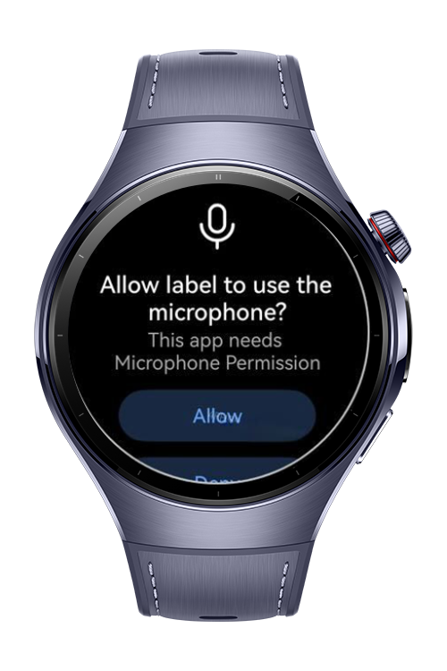
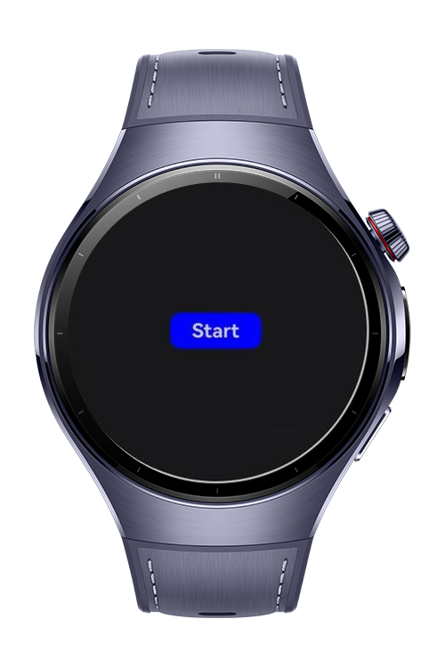
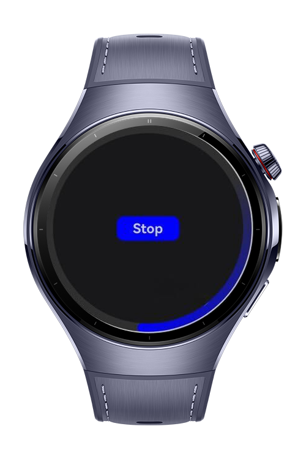

> **Note:** To access all shared projects, get information about environment setup, and view other guides, please visit [Explore-In-HMOS-Wearable Index](https://github.com/Explore-In-HMOS-Wearable/hmos-index).

# How to record voice

This is a minimalist VoiceRecorder app built with ArkTS and ArkUI for HarmonyOS devices. It focuses solely on recording
and saving voice clips quickly and easily.

# Preview

<p align="left">
  
  
  
</p>

# Use Cases

- Voice Recording

# Technology

## Stack
- **Languages**: ArkTS, Typescript
- **Frameworks**: HarmonyOS SDK 5.1.0(18)
- **Tools**: DevEco Studio Vers 5.1.0.842
- **Libraries**: @kit.MediaKit, @kit.AbilityKit, @kit.CoreFileKit, @kit.BasicServicesKit

## Required Permissions
ohos.permission.MICROPHONE
ohos.permission.GET_NETWORK_INFO

# Directory Structure

```entry/src/main/ets/
|---services
| |---AudioService.ets 
| |---RecorderService.ets 
|---entryability
| |---EntryAbility.ets
|---entrybackupability
| |---EntryBackupAbility.ets  
|---pages
| |---Index.ets


```

# Constraints and Restrictions

## Supported Devices

- Huawei Watch 5

# LICENSE

VoiceFinder is distributed under the terms of the MIT License.
See the [LICENSE](/LICENSE) for more information.
